<!--
  generated by scripts/build.py from scripts/profile.json and live GitHub data;
  rebuilt by .github/workflows/profile.yml. edit profile.json, not this file.
-->

<picture><source media="(prefers-color-scheme: dark)" srcset="assets/hero-dark.svg"><source media="(prefers-color-scheme: light)" srcset="assets/hero-light.svg"></picture>

<a href="https://linkedin.com/in/reyyanxahmed"><picture><source media="(prefers-color-scheme: dark)" srcset="assets/link-linkedin-dark.svg"><source media="(prefers-color-scheme: light)" srcset="assets/link-linkedin-light.svg"></picture></a> <a href="mailto:reyyan.ahmed@proton.me"><picture><source media="(prefers-color-scheme: dark)" srcset="assets/link-protonmail-dark.svg"><source media="(prefers-color-scheme: light)" srcset="assets/link-protonmail-light.svg"></picture></a> <a href="https://instagram.com/reyyyaannnnn"><picture><source media="(prefers-color-scheme: dark)" srcset="assets/link-instagram-dark.svg"><source media="(prefers-color-scheme: light)" srcset="assets/link-instagram-light.svg"></picture></a>

 

<picture><source media="(prefers-color-scheme: dark)" srcset="assets/whoami-dark.svg"><source media="(prefers-color-scheme: light)" srcset="assets/whoami-light.svg"></picture>

<picture><source media="(prefers-color-scheme: dark)" srcset="assets/stack-dark.svg"><source media="(prefers-color-scheme: light)" srcset="assets/stack-light.svg"></picture>

<picture><source media="(prefers-color-scheme: dark)" srcset="assets/telemetry-dark.svg"><source media="(prefers-color-scheme: light)" srcset="assets/telemetry-light.svg"></picture>

<picture><source media="(prefers-color-scheme: dark)" srcset="assets/activity-dark.svg"><source media="(prefers-color-scheme: light)" srcset="assets/activity-light.svg"></picture>

<picture><source media="(prefers-color-scheme: dark)" srcset="assets/work-dark.svg"><source media="(prefers-color-scheme: light)" srcset="assets/work-light.svg"></picture>

<a href="https://github.com/reyyanxahmed/cmdr"><picture><source media="(prefers-color-scheme: dark)" srcset="assets/card-cmdr-dark.svg"><source media="(prefers-color-scheme: light)" srcset="assets/card-cmdr-light.svg"></picture></a> <a href="https://github.com/reyyanxahmed/forge"><picture><source media="(prefers-color-scheme: dark)" srcset="assets/card-forge-dark.svg"><source media="(prefers-color-scheme: light)" srcset="assets/card-forge-light.svg"></picture></a>

<a href="https://github.com/reyyanxahmed/capa-rule-agent"><picture><source media="(prefers-color-scheme: dark)" srcset="assets/card-capa-rule-agent-dark.svg"><source media="(prefers-color-scheme: light)" srcset="assets/card-capa-rule-agent-light.svg"></picture></a> <a href="https://github.com/reyyanxahmed/polymind-cli"><picture><source media="(prefers-color-scheme: dark)" srcset="assets/card-polymind-cli-dark.svg"><source media="(prefers-color-scheme: light)" srcset="assets/card-polymind-cli-light.svg"></picture></a>

<a href="https://github.com/reyyanxahmed/linkedin-profile-api"><picture><source media="(prefers-color-scheme: dark)" srcset="assets/card-linkedin-profile-api-dark.svg"><source media="(prefers-color-scheme: light)" srcset="assets/card-linkedin-profile-api-light.svg"></picture></a> <a href="https://github.com/reyyanxahmed/SoloGPT"><picture><source media="(prefers-color-scheme: dark)" srcset="assets/card-sologpt-dark.svg"><source media="(prefers-color-scheme: light)" srcset="assets/card-sologpt-light.svg"></picture></a>

&nbsp;more repositories

 

| repo | what |
|---|---|
| [AndroidSecurity-ADeepDive](https://github.com/reyyanxahmed/AndroidSecurity-ADeepDive) | notes from a deep dive into android security |
| [C-Programming](https://github.com/reyyanxahmed/C-Programming) | university coursework and assignments |
| [The-flappy-bird-documentation](https://github.com/reyyanxahmed/The-flappy-bird-documentation) | documentation site for the flappy bird project |

<picture><source media="(prefers-color-scheme: dark)" srcset="assets/footer-dark.svg"><source media="(prefers-color-scheme: light)" srcset="assets/footer-light.svg"></picture>

